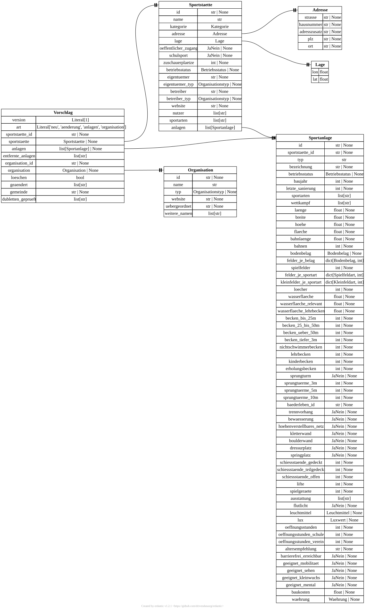

# Datenbestand

Die Quelle der Daten des Sportstättenatlas. Änderungen werden hier gemacht – direkt auf
GitHub, per Pull Request, mit einer CSV-Datei oder über einen Vorschlag auf der Webseite – und
erscheinen nach `uv run sportstaettenatlas seite` auf der Karte. Wer wann was geändert hat,
steht in der Git-Historie. Kontaktdaten gehören nicht hierher ([README](../README.md#kontaktdaten)).

```
RP/                                       Land
└─ 07111-koblenz/                         Kreis (aus der Lage bestimmt)
   └─ 9c24bfa6-…/                         Sportstätte
      ├─ 9c24bfa6-…_meta.json             ihre Angaben: Name, Kategorie, Adresse, Lage …
      ├─ 17abb3c4-….json                  eine Sportanlage, z. B. ein Großspielfeld
      └─ 1fb06acd-….json                  eine Sportanlage, z. B. eine Rundlaufbahn
organisationen/                           Verzeichnis der Organisationen
└─ 3f0c2a8e-….json                        ein Verein, eine Gemeinde, ein Verband …
```

## Begriffe

- Eine **Sportstätte** ist der Standort, z. B. ein Sportpark, ein Schulsportzentrum oder ein
  Freibad – ein Punkt auf der Karte. Ihre Angaben gelten für alle ihre Anlagen.
- Eine **Sportanlage** ist eine Einheit einer Sportstätte, z. B. ein Großspielfeld, eine
  Rundlaufbahn, eine Halle oder ein Becken. Sie liegt im Ordner ihrer Sportstätte und nennt sie
  in `sportstaette_id`. Eine Sportstätte kann (noch) ohne Anlagen sein.
- Eine **Organisation** ist ein Verein, eine Kommune, ein Verband oder ein Unternehmen, das
  Sportstätten besitzt (`eigentuemer`), betreibt (`betreiber`) oder nutzt (`nutzer`). Sie steht
  einmal in `organisationen/`; die Sportstätten nennen sie beim Namen, auch in einer ihrer
  weiteren Schreibweisen. Ihre **Art** (Stadt/Gemeinde, Sportverein im LSB RLP …) steht bei der
  Sportstätte (`betreiber_typ`, `eigentuemer_typ`) oder sonst im Verzeichnis; fehlt sie, ist
  sie unbekannt – aus dem Namen wird nichts geschätzt. Auf der Karte zählt sie als Verein,
  Kommune oder sonstige (`ORGANISATIONSTYPEN` in `modell.py`).
- Der **Kreis-Ordner** ergibt sich aus der Lage (Verwaltungsgebiete VG250). Sportstätten
  außerhalb von Rheinland-Pfalz liegen in `ohne-kreis`; nach einer Änderung der Lage bringt
  `uv run sportstaettenatlas einordnen` den Ordner in den richtigen Kreis.
- **Sportkomplexe** (mehrere Sportstätten an einem Ort) bildet das Modell nicht ab: ein
  gemischtes Gelände ist eine Sportstätte.

## Ändern

**Von Hand:** die JSON-Datei bearbeiten. Eine neue Sportanlage ist eine neue Datei im Ordner
der Sportstätte (neue UUID als Name und `id`, dazu `sportstaette_id` und `typ`), eine neue
Sportstätte ein neuer Ordner im Ordner ihres Kreises mit `<id>_meta.json`, eine neue
Organisation eine Datei in `organisationen/`.

`seite` und `alkis` prüfen den Aufbau beim Lesen und nennen die betroffene Datei, wenn etwas
nicht passt. Werte gegen die Regeln des [Datenmodells](#datenmodell) (z. B. eine PLZ mit sechs
Ziffern) brechen nichts ab und stehen in `results/regelverstoesse.csv`.

### CSV einlesen

`uv run sportstaettenatlas bestand DATEI.csv …` schreibt CSV-Dateien direkt in die
JSON-Dateien. `--probe` zeigt vorher, welche Spalte in welches Feld geht. Erkannt werden:

- der **Export des bisherigen Atlas** (Spalten ID, Name, Sportstättenkategorie, …, Latitude,
  Longitude),
- eine Tabelle der **Sportstätten** (eine Zeile je Sportstätte; `anlagen` darf die Typen ihrer
  Sportanlagen nennen),
- eine Tabelle der **Sportanlagen** (eine Zeile je Anlage, mit `sportstaette_id`; `id` für
  vorhandene, auch die Kurz-ID von der Webseite),
- eine Tabelle der **Organisationen** (`name` und `typ` bzw. „Art“, ohne Kategorie und Lage).

**Spalten** heißen wie das Feld (`plz` oder `adresse.plz`) oder wie seine Beschriftung („PLZ“);
Groß-/Kleinschreibung, Umlaute und Satzzeichen sind egal. Eine Anzahl je Wert steht in einer
Spalte (`felder_je_belag`: `Sand: 3; Rasen: 1`) oder in einer Spalte je Wert
(`felder_je_belag_sand`: `3`). Das Trennzeichen (`;`, `,` oder Tab) und die Kodierung
(UTF-8 oder Windows-1252) werden erkannt. `uv run sportstaettenatlas vorlage` schreibt je
Tabelle eine Vorlage mit allen Spalten und einer Beispielzeile (vor dem Einlesen löschen).

**Werte:**

| Feld | so schreiben |
|---|---|
| Liste | mit `;` getrennt (ohne `;` auch mit Komma): `Fußball; Leichtathletik` |
| Anzahl je Wert | `Sand: 3; Rasen: 1` oder `3× Sand` |
| ja/nein | `ja`, `nein`, auch `x`, `1`/`0`, `wahr`/`falsch` |
| Zahl | `12,5` oder `12.5`; `1.200.000`; ganze Zahlen auch `1.200` |
| Auswahl | wie im Modell, Groß-/Kleinschreibung egal |
| Lage | `lat`/`lon` in Grad (WGS84); UTM-Werte (EPSG:25832) werden umgerechnet |

Ein Wert, der nicht passt, wird übernommen, wie er ist, und erscheint unter den
Regelverstößen.

**Vorhandenes:**

| `--modus` | neue Einträge | vorhandene: leere Felder | vorhandene: gefüllte Felder |
|---|---|---|---|
| `neu` (Standard) | anlegen | – | – |
| `ergaenzen` | anlegen | füllen | bleiben |
| `aktualisieren` | anlegen | füllen | überschreiben |

Gelöscht wird nie etwas, leere Zellen ändern nichts. Eine Tabelle der Sportanlagen legt auch
im Modus `neu` Anlagen bei vorhandenen Sportstätten an. Vorhandene Anlagen findet die ID
(auch die Kurz-ID); ohne ID ist die n-te Anlage eines Typs in der Tabelle die n-te dieses Typs
der Sportstätte. Organisationen findet die ID oder der Name.

## Datenmodell

Der folgende Teil bis zur Überschrift „Typen und Gruppen“ wird aus
`src/sportstaettenatlas/modell.py` erzeugt (`uv run sportstaettenatlas modell`) – bitte dort
ändern, nicht hier.

- **Pflicht:** ohne den Wert ist der Datensatz unvollständig. In den Dateien sind außerdem `id`
  und bei Anlagen `sportstaette_id` Pflicht. Leere Angaben werden weggelassen; ein unbekanntes
  Feld ist ein Regelverstoß.
- **nur für bestimmte Typen:** welche, steht unter [Felder je Anlagentyp](#felder-je-anlagentyp)
  (`MERKMALE` in `modell.py`). Das Formular zeigt das Feld nur dort, die Übersicht zählt es nur
  unter ihnen; erlaubt ist es überall.
- **Auswahl:** die Werte stehen einmal unter [Auswahllisten](#auswahllisten).

<!-- modell:anfang – erzeugt aus src/sportstaettenatlas/modell.py, nicht von Hand ändern -->



### Sportstätte (`<id>_meta.json`)

Der Standort, z. B. ein Sportpark, ein Schulsportzentrum oder ein Freibad.

| Feld | Bezeichnung | Typ | Pflicht | Regeln | Beschreibung |
|---|---|---|---|---|---|
| `id` | ID | Text |  |  | UUID, zugleich Name des Ordners (in der Datei Pflicht) |
| `name` | Name | Text | ja | höchstens 200 Zeichen; nicht leer |  |
| `kategorie` | Sportstättenkategorie | Auswahl [Kategorie](#auswahllisten) | ja |  |  |
| `adresse` | Adresse | Adresse |  |  |  |
| `lage` | Lage | Lage | ja |  | bestimmt Kreis und Gemeinde |
| `oeffentlicher_zugang` | Öffentlicher Zugang | Auswahl [JaNein](#auswahllisten) |  |  |  |
| `schulsport` | Schulsport | Auswahl [JaNein](#auswahllisten) |  |  |  |
| `zuschauerplaetze` | Zuschauerplätze | ganze Zahl |  | ≥ 0; ≤ 100000 |  |
| `betriebsstatus` | Betriebsstatus | Auswahl [Betriebsstatus](#auswahllisten) |  |  |  |
| `eigentuemer` | Eigentümer | Text |  | höchstens 200 Zeichen | Name einer Organisation (Verzeichnis daten/organisationen/), keine Personen |
| `eigentuemer_typ` | Art des Eigentümers | Auswahl [Organisationstyp](#auswahllisten) |  | braucht `eigentuemer` |  |
| `betreiber` | Betreiber | Text |  | höchstens 200 Zeichen | Name einer Organisation (Verzeichnis daten/organisationen/), keine Personen |
| `betreiber_typ` | Art des Betreibers | Auswahl [Organisationstyp](#auswahllisten) |  | braucht `betreiber` |  |
| `website` | Webseite | Text |  | Muster `^https?://\S+\.\S+$` | vollständige Adresse mit https:// |
| `nutzer` | Nutzer | Liste von Text |  |  | Vereine und andere Organisationen, die die Sportstätte nutzen (Verzeichnis daten/organisationen/) |
| `sportarten` | Sportarten | Liste von Text |  |  |  |
| `anlagen` | Sportanlagen | Liste von Sportanlage |  |  | stehen als eigene Dateien im Ordner der Sportstätte, nicht in `<id>_meta.json` |

```json
{
  "id": "9c24bfa6-71c1-4164-b226-061f0a139997",
  "name": "Sportplatz Musterdorf",
  "kategorie": "Sportplatz",
  "adresse": {
    "strasse": "Am Weg",
    "hausnummer": "1",
    "plz": "56068",
    "ort": "Koblenz"
  },
  "lage": {
    "lon": 7.59,
    "lat": 50.35
  },
  "betreiber": "TuS Musterdorf e.V.",
  "betreiber_typ": "Sportverein im LSB RLP",
  "sportarten": [
    "Fußball",
    "Leichtathletik"
  ]
}
```

### Adresse

| Feld | Bezeichnung | Typ | Pflicht | Regeln | Beschreibung |
|---|---|---|---|---|---|
| `strasse` | Straße | Text |  | höchstens 150 Zeichen |  |
| `hausnummer` | Hausnummer | Text |  | Muster `^\d+\s?[a-zA-Z]?(\s?[-/]\s?\d+\s?[a-zA-Z]?)?$`; höchstens 12 Zeichen | z. B. 12, 12a oder 2-4 |
| `adresszusatz` | Adresszusatz | Text |  | höchstens 150 Zeichen | z. B. Eingang Schulhof |
| `plz` | PLZ | Text |  | Muster `^\d{5}$` | fünf Ziffern |
| `ort` | Ort | Text |  | höchstens 100 Zeichen |  |

### Lage

Immer WGS84 (EPSG:4326), Grad mit Dezimalstellen.

| Feld | Bezeichnung | Typ | Pflicht | Regeln | Beschreibung |
|---|---|---|---|---|---|
| `lon` | Längengrad | Zahl | ja | ≥ 5.8; ≤ 9 | WGS84 |
| `lat` | Breitengrad | Zahl | ja | ≥ 48.8; ≤ 51.1 | WGS84 |

### Sportanlage (`<anlage-id>.json`)

Eine Einheit einer Sportstätte, z. B. ein Großspielfeld, eine Halle oder ein Becken.

| Feld | Bezeichnung | Typ | Pflicht | Regeln | Beschreibung |
|---|---|---|---|---|---|
| `id` | ID | Text |  |  | UUID, zugleich der Dateiname (in der Datei Pflicht) |
| `sportstaette_id` | Sportstätte | Text |  |  | ID der Sportstätte, zu der die Anlage gehört, = Name des Ordners (in der Datei Pflicht) |
| `typ` | Typ | Text | ja | höchstens 100 Zeichen; nicht leer | einheitlicher Typ aus src/sportstaettenatlas/anlagen.py, z. B. „Großspielfeld“ |
| `bezeichnung` | Name | Text |  | höchstens 100 Zeichen | eigener Name der Anlage, z. B. „Halle 1“, „Kunstrasen B“ |
| `betriebsstatus` | Betriebsstatus | Auswahl [Betriebsstatus](#auswahllisten) |  |  |  |
| `baujahr` | Baujahr | ganze Zahl |  | ≥ 1800; ≤ 2100 |  |
| `letzte_sanierung` | Letzte Sanierung | ganze Zahl |  | ≥ 1800; ≤ 2100 | Jahr |
| `sportarten` | Sportarten | Liste von Text |  |  |  |
| `wettkampf` | Wettkampfeignung | Liste von Text |  | Teil von `sportarten` | Sportarten, für die die Anlage wettkampfgeeignet ist (müssen unter Sportarten stehen) |
| `laenge` | Länge | Zahl |  | ≥ 0; in m; nur für bestimmte Typen ([Felder je Anlagentyp](#felder-je-anlagentyp)) | der Sportfläche |
| `breite` | Breite | Zahl |  | ≥ 0; in m; nur für bestimmte Typen ([Felder je Anlagentyp](#felder-je-anlagentyp)) | der Sportfläche |
| `hoehe` | Höhe | Zahl |  | ≥ 0; in m; nur für bestimmte Typen ([Felder je Anlagentyp](#felder-je-anlagentyp)) | lichte Höhe der Halle |
| `flaeche` | Fläche | Zahl |  | ≥ 0; in m²; nur für bestimmte Typen ([Felder je Anlagentyp](#felder-je-anlagentyp)) | nutzbare Sportfläche, wenn nicht Länge × Breite (z. B. Reitplatz) |
| `bahnlaenge` | Bahnlänge | Zahl |  | ≥ 0; in m; nur für bestimmte Typen ([Felder je Anlagentyp](#felder-je-anlagentyp)) |  |
| `bahnen` | Bahnen | ganze Zahl |  | ≥ 0; nur für bestimmte Typen ([Felder je Anlagentyp](#felder-je-anlagentyp)) | Zahl der Lauf-, Schwimm-, Kegel- oder Schießbahnen |
| `bodenbelag` | Bodenbelag | Auswahl [Bodenbelag](#auswahllisten) |  | nur für bestimmte Typen ([Felder je Anlagentyp](#felder-je-anlagentyp)) |  |
| `felder_je_belag` | Felder je Belag | Anzahl je Wert |  | Anzahl je [Bodenbelag](#auswahllisten); nur für bestimmte Typen ([Felder je Anlagentyp](#felder-je-anlagentyp)) | z. B. Tennisplätze: 3 Sand, 1 Kunstrasen |
| `spielfelder` | Spielfelder | ganze Zahl |  | ≥ 0; nur für bestimmte Typen ([Felder je Anlagentyp](#felder-je-anlagentyp)) | Zahl, wenn nicht nach Sportart bekannt |
| `felder_je_sportart` | Spielfelder je Sportart | Anzahl je Wert |  | Anzahl je [Spielfeldart](#auswahllisten); nur für bestimmte Typen ([Felder je Anlagentyp](#felder-je-anlagentyp)) | markierte Felder, z. B. 3 Badminton, 1 Handball |
| `kleinfelder_je_sportart` | Kleinfelder je Sportart | Anzahl je Wert |  | Anzahl je [Kleinfeldart](#auswahllisten); nur für bestimmte Typen ([Felder je Anlagentyp](#felder-je-anlagentyp)) |  |
| `loecher` | Löcher | ganze Zahl |  | ≥ 0; nur für bestimmte Typen ([Felder je Anlagentyp](#felder-je-anlagentyp)) | Golf, Bahnengolf |
| `wasserflaeche` | Wasserfläche | Zahl |  | ≥ 0; in m²; nur für bestimmte Typen ([Felder je Anlagentyp](#felder-je-anlagentyp)) | gesamt |
| `wasserflaeche_relevant` | Relevante Wasserfläche | Zahl |  | ≥ 0; in m²; nur für bestimmte Typen ([Felder je Anlagentyp](#felder-je-anlagentyp)) | ohne Kaltwassertret-, Warmsprudelbecken usw. |
| `wasserflaeche_lehrbecken` | Wasserfläche Lern- und Kursbecken | Zahl |  | ≥ 0; in m²; nur für bestimmte Typen ([Felder je Anlagentyp](#felder-je-anlagentyp)) |  |
| `becken_bis_25m` | Becken bis 25 m | ganze Zahl |  | ≥ 0; nur für bestimmte Typen ([Felder je Anlagentyp](#felder-je-anlagentyp)) |  |
| `becken_25_bis_50m` | Becken 25 bis 50 m | ganze Zahl |  | ≥ 0; nur für bestimmte Typen ([Felder je Anlagentyp](#felder-je-anlagentyp)) |  |
| `becken_ueber_50m` | Becken über 50 m | ganze Zahl |  | ≥ 0; nur für bestimmte Typen ([Felder je Anlagentyp](#felder-je-anlagentyp)) |  |
| `becken_tiefer_3m` | Becken tiefer als 3 m | ganze Zahl |  | ≥ 0; nur für bestimmte Typen ([Felder je Anlagentyp](#felder-je-anlagentyp)) |  |
| `nichtschwimmerbecken` | Nichtschwimmerbecken | ganze Zahl |  | ≥ 0; nur für bestimmte Typen ([Felder je Anlagentyp](#felder-je-anlagentyp)) |  |
| `lehrbecken` | Lehrbecken | ganze Zahl |  | ≥ 0; nur für bestimmte Typen ([Felder je Anlagentyp](#felder-je-anlagentyp)) |  |
| `kinderbecken` | Kinderbecken | ganze Zahl |  | ≥ 0; nur für bestimmte Typen ([Felder je Anlagentyp](#felder-je-anlagentyp)) |  |
| `erholungsbecken` | Erholungsbecken | ganze Zahl |  | ≥ 0; nur für bestimmte Typen ([Felder je Anlagentyp](#felder-je-anlagentyp)) |  |
| `sprungturm` | Sprungturm | Auswahl [JaNein](#auswahllisten) |  | nur für bestimmte Typen ([Felder je Anlagentyp](#felder-je-anlagentyp)) | mindestens einer |
| `sprungtuerme_3m` | Sprungtürme 3 m | ganze Zahl |  | ≥ 0; nur für bestimmte Typen ([Felder je Anlagentyp](#felder-je-anlagentyp)) |  |
| `sprungtuerme_5m` | Sprungtürme 5 m | ganze Zahl |  | ≥ 0; nur für bestimmte Typen ([Felder je Anlagentyp](#felder-je-anlagentyp)) |  |
| `sprungtuerme_10m` | Sprungtürme 10 m | ganze Zahl |  | ≥ 0; nur für bestimmte Typen ([Felder je Anlagentyp](#felder-je-anlagentyp)) |  |
| `baederleben_id` | ID bei baederleben.de | Text |  | höchstens 50 Zeichen; nur für bestimmte Typen ([Felder je Anlagentyp](#felder-je-anlagentyp)) |  |
| `trennvorhang` | Trennvorhang | Auswahl [JaNein](#auswahllisten) |  | nur für bestimmte Typen ([Felder je Anlagentyp](#felder-je-anlagentyp)) | zur Hallenteilung oder für eine Bühne |
| `bewaesserung` | Bewässerung | Auswahl [JaNein](#auswahllisten) |  | nur für bestimmte Typen ([Felder je Anlagentyp](#felder-je-anlagentyp)) |  |
| `hoehenverstellbares_netz` | Höhenverstellbares Netz | Auswahl [JaNein](#auswahllisten) |  | nur für bestimmte Typen ([Felder je Anlagentyp](#felder-je-anlagentyp)) |  |
| `kletterwand` | Kletterwand | Auswahl [JaNein](#auswahllisten) |  | nur für bestimmte Typen ([Felder je Anlagentyp](#felder-je-anlagentyp)) |  |
| `boulderwand` | Boulderwand | Auswahl [JaNein](#auswahllisten) |  | nur für bestimmte Typen ([Felder je Anlagentyp](#felder-je-anlagentyp)) |  |
| `dressurplatz` | Dressurplatz | Auswahl [JaNein](#auswahllisten) |  | nur für bestimmte Typen ([Felder je Anlagentyp](#felder-je-anlagentyp)) |  |
| `springplatz` | Springplatz | Auswahl [JaNein](#auswahllisten) |  |  |  |
| `schiessstaende_gedeckt` | Schießstände gedeckt | ganze Zahl |  | ≥ 0; nur für bestimmte Typen ([Felder je Anlagentyp](#felder-je-anlagentyp)) |  |
| `schiessstaende_teilgedeckt` | Schießstände teilgedeckt | ganze Zahl |  | ≥ 0; nur für bestimmte Typen ([Felder je Anlagentyp](#felder-je-anlagentyp)) |  |
| `schiessstaende_offen` | Schießstände offen | ganze Zahl |  | ≥ 0; nur für bestimmte Typen ([Felder je Anlagentyp](#felder-je-anlagentyp)) |  |
| `lifte` | Lifte | ganze Zahl |  | ≥ 0; nur für bestimmte Typen ([Felder je Anlagentyp](#felder-je-anlagentyp)) |  |
| `spielgeraete` | Spielgeräte | ganze Zahl |  | ≥ 0 |  |
| `ausstattung` | Weitere Ausstattung | Liste von Text |  |  | z. B. Umkleiden, Anzeigetafel |
| `flutlicht` | Flutlicht | Auswahl [JaNein](#auswahllisten) |  |  |  |
| `leuchtmittel` | Leuchtmittel | Auswahl [Leuchtmittel](#auswahllisten) |  |  |  |
| `lux` | Beleuchtungsstärke | Auswahl [Luxwert](#auswahllisten) |  | in lx |  |
| `oeffnungsstunden` | Öffnungsstunden | ganze Zahl |  | ≥ 0; ≤ 8784; in h | im Jahr, insgesamt |
| `oeffnungsstunden_schule` | davon Schulsport | ganze Zahl |  | ≥ 0; ≤ 8784; in h | Stunden im Jahr |
| `oeffnungsstunden_verein` | davon Vereine | ganze Zahl |  | ≥ 0; ≤ 8784; in h | Stunden im Jahr |
| `altersempfehlung` | Altersempfehlung | Text |  | höchstens 50 Zeichen | z. B. 6–12 Jahre |
| `barrierefrei_erreichbar` | Barrierefrei erreichbar | Auswahl [JaNein](#auswahllisten) |  |  |  |
| `geeignet_mobilitaet` | Geeignet bei eingeschränkter Mobilität | Auswahl [JaNein](#auswahllisten) |  |  |  |
| `geeignet_sehen` | Geeignet bei Sehbeeinträchtigung | Auswahl [JaNein](#auswahllisten) |  |  |  |
| `geeignet_kleinwuchs` | Geeignet für Kleinwüchsige | Auswahl [JaNein](#auswahllisten) |  |  |  |
| `geeignet_mental` | Geeignet bei geistiger Beeinträchtigung | Auswahl [JaNein](#auswahllisten) |  |  |  |
| `baukosten` | Baukosten | Zahl |  | ≥ 0; braucht `waehrung`; Einheit aus `waehrung` | damalige Kosten |
| `waehrung` | Währung | Auswahl [Waehrung](#auswahllisten) |  |  | der Baukosten |

```json
{
  "id": "17abb3c4-7493-5549-a6ca-f432ef00fba3",
  "sportstaette_id": "9c24bfa6-71c1-4164-b226-061f0a139997",
  "typ": "Großspielfeld",
  "bezeichnung": "Kunstrasen B",
  "betriebsstatus": "in Betrieb",
  "baujahr": 1998,
  "sportarten": [
    "Fußball"
  ],
  "wettkampf": [
    "Fußball"
  ],
  "laenge": 105,
  "breite": 68,
  "bodenbelag": "Kunstrasen",
  "flutlicht": "ja",
  "baukosten": 1200000,
  "waehrung": "DM"
}
```

### Organisation (`organisationen/<id>.json`)

Verein, Kommune, Verband, Unternehmen … als Eigentümer, Betreiber oder Nutzer von
    Sportstätten (daten/organisationen/<LAND>/<Ordner der Art>/<id>.json). Sportstätten nennen sie in
    `eigentuemer`, `betreiber` und `nutzer` beim Namen; auch die weiteren Schreibweisen
    gelten. Keine Personen, keine Kontaktdaten.

| Feld | Bezeichnung | Typ | Pflicht | Regeln | Beschreibung |
|---|---|---|---|---|---|
| `id` | ID | Text |  |  | UUID, zugleich der Dateiname (in der Datei Pflicht) |
| `name` | Name | Text | ja | höchstens 200 Zeichen; nicht leer | wie er bei den Sportstätten steht |
| `typ` | Art | Auswahl [Organisationstyp](#auswahllisten) |  |  | bestimmt auch den Ordner in daten/organisationen/ |
| `ars` | Regionalschlüssel | Text |  | Muster `^\d{5}(\d{4}(\d{3})?)?$` | amtlicher Schlüssel einer Gebietskörperschaft: Kreis 5, Verbandsgemeinde 9, Gemeinde 12 Stellen |
| `website` | Webseite | Text |  | Muster `^https?://\S+\.\S+$` | vollständige Adresse mit https:// |
| `uebergeordnet` | Übergeordnet | Text |  | höchstens 200 Zeichen | Name der übergeordneten Organisation, z. B. des Verbands |
| `weitere_namen` | Weitere Schreibweisen | Liste von Text |  |  | andere Namen, unter denen Sportstätten sie nennen |

```json
{
  "id": "3f0c2a8e-5b1d-4e57-9a0c-6d2e1b7f4a90",
  "name": "TuS Musterdorf e.V.",
  "typ": "Sportverein im LSB RLP",
  "website": "https://tus-musterdorf.example",
  "weitere_namen": [
    "TuS Musterdorf",
    "Turn- und Sportverein Musterdorf"
  ]
}
```

### Vorschlag (Formular → LimeSurvey, Frage `data`)

Was das Formular „Vorschlag“ als JSON in die LimeSurvey-Frage „data“ schreibt.

| Feld | Bezeichnung | Typ | Pflicht | Regeln | Beschreibung |
|---|---|---|---|---|---|
| `version` | Version des Formats | Auswahl |  | „1“ |  |
| `art` | Art | Auswahl | ja | „neu“, „aenderung“, „anlagen“, „organisation“ | neu: neue Sportstätte mit Anlagen; aenderung: Angaben einer Sportstätte; anlagen: Sportanlagen einer Sportstätte; organisation: Organisation anlegen, ändern oder löschen |
| `sportstaette_id` | Sportstätte | Text |  |  | ID der geänderten Sportstätte |
| `sportstaette` | Angaben der Sportstätte | Sportstaette |  |  | vollständig, nach der Änderung (bei neu und aenderung) |
| `anlagen` | Sportanlagen | Liste von Sportanlage |  |  | alle Anlagen nach der Änderung (bei neu und anlagen); vorhandene mit ihrer Kurz-ID (Anfang der UUID), neue ohne |
| `entfernte_anlagen` | Entfernte Sportanlagen | Liste von Text |  |  | Kurz-IDs |
| `organisation_id` | Organisation | Text |  |  | ID der geänderten oder gelöschten Organisation (fehlt bei einer neuen) |
| `organisation` | Angaben der Organisation | Organisation |  |  | vollständig, nach der Änderung (nicht beim Löschen) |
| `loeschen` | Löschen | boolean |  |  | die Organisation aus dem Verzeichnis entfernen |
| `geaendert` | Geänderte Felder | Liste von Text |  |  |  |
| `gemeinde` | Gemeinde | Text |  |  | Regionalschlüssel der Gemeinde an der Lage |
| `dubletten_geprueft` | Geprüfte Doppelungen | Liste von Text |  |  | IDs ähnlicher Sportstätten, die als verschieden bestätigt wurden |

```json
{
  "version": 1,
  "art": "anlagen",
  "sportstaette_id": "9c24bfa6-71c1-4164-b226-061f0a139997",
  "anlagen": [
    {
      "id": "17abb3c4",
      "typ": "Großspielfeld",
      "baujahr": 1998
    },
    {
      "typ": "Kleinspielfeld"
    }
  ],
  "entfernte_anlagen": [
    "1fb06acd"
  ]
}
```

### Felder je Anlagentyp

Felder, die nicht hier stehen, gelten für alle Typen.

| Anlagentypen | Felder |
|---|---|
| Sport-/Turnhalle untermaßig, Einfachsporthalle, Zweifachsporthalle, Dreifachsporthalle, Großsporthalle, Freilufthalle, Sporthalle Sondermaße, Sporthalle (Größe unbekannt) | Länge, Breite, Höhe, Bodenbelag, Spielfelder je Sportart |
| Bühne | Länge, Breite, Höhe, Trennvorhang |
| Squashhalle, Paddleplatz | Länge, Breite, Höhe, Bodenbelag, Spielfelder |
| Kurs-/Übungsraum, Gerätebereich, Skateplatz, Rollsportplatz | Bodenbelag, Fläche |
| Großspielfeld | Länge, Breite, Bodenbelag, Bewässerung, Spielfelder je Sportart, Kleinfelder je Sportart |
| Kleinspielfeld, Nicht normiertes Spielfeld | Länge, Breite, Bodenbelag, Bewässerung, Spielfelder je Sportart |
| Rundlaufbahn, Kurzstreckenbahn, Radrennbahn | Bodenbelag, Länge, Bahnen |
| Tennishalle | Länge, Breite, Höhe, Felder je Belag |
| Tennisplatz | Bewässerung, Felder je Belag |
| Schießen | Schießstände gedeckt, Schießstände offen, Schießstände teilgedeckt |
| Führ- und Longierplatz, Sportkindergarten | Fläche |
| Führ- und Longierhalle, Stall, Eissporthalle, Bootshaus/-halle | Länge, Breite, Höhe |
| Rennbahn, Eisschnelllaufbahn | Länge, Bahnen |
| Fahrparcours, Bob-/Rodelbahn, Mountainbikestrecke, BMX-Strecke, Enduro-Strecke, Kartbahn, Motocross-Strecke, Motorsport-Rennstrecke, SuperMoto-Strecke | Länge |
| Reitplatz | Bodenbelag, Fläche, Bewässerung, Dressurplatz |
| Reithalle, Radsporthalle, Rollsporthalle, Skatehalle | Länge, Breite, Höhe, Bodenbelag |
| Hallenbad, Freibad, Cabriobad, Kombibad | Becken bis 25 m, Becken 25 bis 50 m, Becken über 50 m, Nichtschwimmerbecken, Kinderbecken, Erholungsbecken, Lehrbecken, Wasserfläche, Wasserfläche Lern- und Kursbecken, Bahnlänge, Relevante Wasserfläche, Becken tiefer als 3 m, Sprungturm, Sprungtürme 3 m, Sprungtürme 5 m, Sprungtürme 10 m, ID bei baederleben.de |
| Naturbad | Wasserfläche, Nichtschwimmerbecken, Bahnlänge, Relevante Wasserfläche, Becken tiefer als 3 m, Sprungturm, Sprungtürme 3 m, Sprungtürme 5 m, Sprungtürme 10 m, ID bei baederleben.de |
| Golfplatz | Löcher |
| Bahnengolf, Bowlingbahn, Kegelbahn | Bahnen |
| Luftsport, Eissportanlage ungedeckt | Länge, Breite |
| Alpine Skianlage | Länge, Lifte |
| Skisprungschanze | Länge, Höhe |
| Klettersporthalle | Länge, Breite, Höhe, Boulderwand, Kletterwand |
| Klettersportanlage Outdoor | Boulderwand, Kletterwand |
| Sporthafen | Wasserfläche, Fläche |
| Regattastrecke | Wasserfläche, Fläche, Bahnen |
| Wildwasseranlage | Länge, Breite, Wasserfläche |
| Rundrennstrecke (Motorboot) | Länge, Wasserfläche |
| Bouleanlage | Bodenbelag, Bahnen |
| Volleyballfeld | Bodenbelag, Bewässerung, Höhenverstellbares Netz |
| Weit- und Dreisprunganlage, Kugelstoßanlage, Hindernislauf mit Wassergraben, Hochsprunganlage, Stabhochsprunganlage, Diskus- und Hammerwurfanlage, Speerwurfanlage, Ballwand, Polofeld, Springparcours, Geländeparcours, Freestyleanlage, Skilanglauf- und Biathlonanlage, Bewegungsparcours, Calisthenicsanlage |  |

### Auswahllisten

| Liste | Werte |
|---|---|
| Kategorie | „Sportplatz“, „Sporthalle“, „Tennissportstätte“, „Öffentlicher Sport- und Bewegungsraum“, „Reitsportstätte“, „Schwimmsportstätte“, „Schießsportstätte“, „Fitnessstudio“, „Golfsportstätte“, „Roll- und Skatesportstätte“, „Sportgelegenheiten in sonstigen Gebäuden“, „Radsportstätte“, „Flugsportstätte“, „Wintersportstätte“, „Wassersportstätte“, „Klettersportstätte“, „Motorsportstätte“, „Eissportstätte“, „Leistungsstützpunkt“, „Segelsportstätte“ |
| Betriebsstatus | „in Betrieb“, „vorübergehend geschlossen“, „stillgelegt/geschlossen“, „im Bau“, „in Planung“ |
| Organisationstyp | „Bund“, „Land Rheinland-Pfalz“, „Landkreis“, „Kreisfreie Stadt“, „Verbandsgemeinde“, „Verbandsfreie Gemeinde“, „Verbandsangehörige Stadt“, „Ortsgemeinde“, „Stadt/Gemeinde“, „Kommunales Unternehmen“, „Zweckverband“, „Sportverein im LSB RLP“, „Sonstiger Sportverein“, „Sportverband im LSB RLP“, „Sonstiger Sportverband“, „Privatwirtschaftlich/kommerziell“, „Sonstige“ |
| JaNein | „ja“, „nein“ |
| Waehrung | „€“, „DM“, „RM“ |
| Bodenbelag | „Sportparkett“, „Rasen“, „Kunstrasen“, „Hartplatz/Tenne“, „Beton“, „Sand“, „Kunststoff“, „Teppich“, „Granulat“, „Linoleum“, „Sonstiges“ |
| Spielfeldart | „Fußball“, „Handball“, „Basketball“, „Volleyball“, „Beachvolleyball“, „Badminton“, „Futsal“, „Funino“, „Hallenhockey“, „Feldhockey“, „Faustball“, „American Football“, „Rugby“, „Baseball“, „Softball“, „Cricket“, „Streetball“, „Sonstige“ |
| Kleinfeldart | „Fußball“, „Hockey“, „Basketball“, „Streetball“, „Sonstige“ |
| Leuchtmittel | „LED“, „Leuchtröhren“, „Sonstige“ |
| Luxwert | „100“, „150“, „200“, „300“, „500“, „750“, „1000“ |

<!-- modell:ende -->

## Typen und Gruppen der Sportanlagen

`typ` kommt aus einer festen Liste in `src/sportstaettenatlas/anlagen.py` (Typen in Gruppen,
nach denen Karte, Formular und Übersicht ordnen). Exporte schreiben dieselbe Anlage oft
verschieden („Nichtnormiertes Spielfeld“, „Großspielfeld (ab 5.000 m²)“); beim Einlesen wird
daraus ein Typ. Ein unbekannter Typ ist
erlaubt und landet über Stichwörter in einer Gruppe oder unter „Weitere“. Neue Typen kommen in
`anlagen.py`.

Die **Kategorie** einer Sportstätte und der **Typ** einer Sportanlage sind getrennte Listen,
ohne Regel, welcher Typ zu welcher Kategorie gehört: Ein „Sportplatz“ kann ein Großspielfeld,
eine Rundlaufbahn und auch Tennisplätze enthalten. Das Formular schlägt zuerst die Typen vor, die im Bestand
bei der gewählten Kategorie vorkommen.

## IDs

- **Sportstätte:** die UUID aus der Quelle, stabil über Änderungen hinweg. Neue bekommen
  eine neue UUID; aus einer CSV ohne `id` eine feste aus Name und Lage.
- **Sportanlage:** beim Einlesen aus Sportstätte, Typ und laufender Nummer abgeleitet (ein
  zweites Einlesen ergibt dieselben IDs); von Hand angelegte bekommen eine neue UUID. Webseite
  und Vorschläge nennen kurz den Anfang der UUID (z. B. `17abb3c4`).
- **Organisation:** aus dem Namen abgeleitet, wenn sie aus dem Bestand oder einer CSV entsteht.

Woher eine Angabe stammt, wer sie geändert hat und wann, steht in der Git-Historie.
