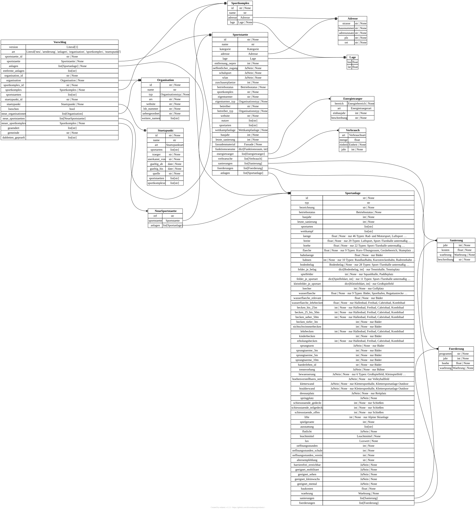

<!-- erzeugt aus src/sportstaettenatlas/modell/ mit `uv run sportstaettenatlas modell` – nicht von Hand ändern -->

# Datenmodell



### Sportstätte (`<id>_meta.json`)

Der Standort, z. B. ein Sportpark, ein Schulsportzentrum oder ein Freibad.

| Feld | Bezeichnung | Typ | Pflicht | Regeln | Beschreibung |
|---|---|---|---|---|---|
| `id` | ID | Text |  |  | UUID, zugleich Name des Ordners (in der Datei Pflicht) |
| `name` | Name | Text | ja | höchstens 200 Zeichen; nicht leer |  |
| `kategorie` | Sportstättenkategorie | Auswahl [Kategorie](#auswahllisten) | ja |  |  |
| `adresse` | Adresse | Adresse |  |  |  |
| `lage` | Lage | Lage | ja |  | bestimmt Kreis und Gemeinde |
| `entfernung_oepnv` | Entfernung zum ÖPNV | ganze Zahl |  | ≥ 0; ≤ 100000; in m | zur nächsten Haltestelle |
| `oeffentlicher_zugang` | Öffentlicher Zugang | Auswahl [JaNein](#auswahllisten) |  |  |  |
| `schulsport` | Schulsport | Auswahl [JaNein](#auswahllisten) |  |  |  |
| `wlan` | WLAN | Auswahl [JaNein](#auswahllisten) |  |  |  |
| `zuschauerplaetze` | Zuschauerplätze | ganze Zahl |  | ≥ 0; ≤ 100000 |  |
| `betriebsstatus` | Betriebsstatus | Auswahl [Betriebsstatus](#auswahllisten) |  |  |  |
| `sportkomplex` | Sportkomplex | Text |  | Muster `^[0-9a-f]{8}-[0-9a-f]{4}-[0-9a-f]{4}-[0-9a-f]{4}-[0-9a-f]{12}$` | ID eines Sportkomplexes (daten/<LAND>/<Kreis>/sportkomplexe/), nur wenn mehrere Sportstätten an einem Ort zusammengehören |
| `eigentuemer` | Eigentümer | Text |  | höchstens 200 Zeichen | Name einer Organisation (Verzeichnis daten/organisationen/), keine Personen |
| `eigentuemer_typ` | Art des Eigentümers | Auswahl [Organisationstyp](#auswahllisten) |  | braucht `eigentuemer` |  |
| `betreiber` | Betreiber | Text |  | höchstens 200 Zeichen | Name einer Organisation (Verzeichnis daten/organisationen/), keine Personen |
| `betreiber_typ` | Art des Betreibers | Auswahl [Organisationstyp](#auswahllisten) |  | braucht `betreiber` |  |
| `website` | Webseite | Text |  | Muster `^https?://\S+\.\S+$` | vollständige Adresse mit https:// |
| `nutzer` | Nutzer | Liste von Text |  |  | Vereine und andere Organisationen, die die Sportstätte nutzen (Verzeichnis daten/organisationen/) |
| `sportarten` | Sportarten | Liste von Text |  |  |  |
| `wettkampfanlage` | Wettkampfanlage | Auswahl [Wettkampfanlage](#auswahllisten) |  |  |  |
| `baujahr` | Baujahr | ganze Zahl |  | ≥ 1800; ≤ 2100 | des Gebäudes bzw. Geländes |
| `letzte_sanierung` | Letzte Sanierung | ganze Zahl |  | ≥ 1800; ≤ 2100 | Jahr |
| `fassadenmaterial` | Fassadenmaterial | Auswahl [Fassade](#auswahllisten) |  |  |  |
| `funktionsraeume` | Funktionsräume | Anzahl je Wert |  | Anzahl je [Funktionsraum](#auswahllisten) | Anzahl je Art, z. B. 4 Umkleiden |
| `energietraeger` | Energieträger | Liste von Energietraeger |  |  |  |
| `verbraeuche` | Jahresverbräuche | Liste von Verbrauch |  |  |  |
| `sanierungen` | Sanierungen | Liste von Sanierung |  |  |  |
| `foerderungen` | Förderungen | Liste von Foerderung |  |  |  |
| `anlagen` | Sportanlagen | Liste von Sportanlage |  |  | stehen als eigene Dateien im Ordner der Sportstätte, nicht in `<id>_meta.json` |

```json
{
  "id": "9c24bfa6-71c1-4164-b226-061f0a139997",
  "name": "Sportplatz Musterdorf",
  "kategorie": "Sportplatz",
  "adresse": {
    "strasse": "Am Weg",
    "hausnummer": "1",
    "plz": "56068",
    "ort": "Koblenz"
  },
  "lage": {
    "lon": 7.5938,
    "lat": 50.3512
  },
  "betreiber": "TuS Musterdorf e.V.",
  "betreiber_typ": "Sportverein im LSB RLP",
  "sportarten": [
    "Fußball",
    "Leichtathletik"
  ]
}
```

### Adresse

| Feld | Bezeichnung | Typ | Pflicht | Regeln | Beschreibung |
|---|---|---|---|---|---|
| `strasse` | Straße | Text |  | höchstens 150 Zeichen |  |
| `hausnummer` | Hausnummer | Text |  | Muster `^\d+\s?[a-zA-Z]?(\s?[-/]\s?\d+\s?[a-zA-Z]?)?$`; höchstens 12 Zeichen | z. B. 12, 12a oder 2-4 |
| `adresszusatz` | Adresszusatz | Text |  | höchstens 150 Zeichen | z. B. Eingang Schulhof |
| `plz` | PLZ | Text |  | Muster `^\d{5}$` | fünf Ziffern |
| `ort` | Ort | Text |  | höchstens 100 Zeichen |  |

### Lage

Immer WGS84 (EPSG:4326), Grad mit Dezimalstellen.

| Feld | Bezeichnung | Typ | Pflicht | Regeln | Beschreibung |
|---|---|---|---|---|---|
| `lon` | Längengrad | Zahl | ja | ≥ 5.8; ≤ 9; mindestens 4 Nachkommastellen | WGS84 |
| `lat` | Breitengrad | Zahl | ja | ≥ 48.8; ≤ 51.1; mindestens 4 Nachkommastellen | WGS84 |

### Energieträger

Ein Energieträger einer Sportstätte, z. B. Erdgas für die Heizung.

| Feld | Bezeichnung | Typ | Pflicht | Regeln | Beschreibung |
|---|---|---|---|---|---|
| `bereich` | Bereich | Auswahl [Energiebereich](#auswahllisten) |  |  | Heizung, Warmwasser oder Strom |
| `art` | Art | Auswahl [Energietraegerart](#auswahllisten) | ja |  |  |
| `einbaujahr` | Einbaujahr | ganze Zahl |  | ≥ 1800; ≤ 2100 |  |
| `beschreibung` | Beschreibung | Text |  | höchstens 500 Zeichen |  |

### Jahresverbrauch

Ein Jahresverbrauch einer Sportstätte (Menge und Einheit).

| Feld | Bezeichnung | Typ | Pflicht | Regeln | Beschreibung |
|---|---|---|---|---|---|
| `art` | Art | Auswahl [Verbrauchsart](#auswahllisten) | ja |  |  |
| `menge` | Menge | Zahl | ja | ≥ 0 |  |
| `einheit` | Einheit | Auswahl [Einheit](#auswahllisten) |  |  |  |
| `jahr` | Jahr | ganze Zahl |  | ≥ 1990; ≤ 2100 |  |

### Sanierung

Eine Sanierung (Sportstätte oder Sportanlage).

| Feld | Bezeichnung | Typ | Pflicht | Regeln | Beschreibung |
|---|---|---|---|---|---|
| `jahr` | Jahr | ganze Zahl |  | ≥ 1800; ≤ 2100 |  |
| `kosten` | Kosten | Zahl |  | ≥ 0; braucht `waehrung` |  |
| `waehrung` | Währung | Auswahl [Waehrung](#auswahllisten) |  |  |  |
| `beschreibung` | Beschreibung | Text |  | höchstens 1000 Zeichen |  |

### Förderung

Eine Förderung (Sportstätte oder Sportanlage).

| Feld | Bezeichnung | Typ | Pflicht | Regeln | Beschreibung |
|---|---|---|---|---|---|
| `programm` | Programm | Text |  | höchstens 300 Zeichen |  |
| `jahr` | Jahr | ganze Zahl |  | ≥ 1800; ≤ 2100 |  |
| `hoehe` | Höhe | Zahl |  | ≥ 0; braucht `waehrung` |  |
| `waehrung` | Währung | Auswahl [Waehrung](#auswahllisten) |  |  |  |

### Sportanlage (`<anlage-id>.json`)

Eine Einheit einer Sportstätte, z. B. ein Großspielfeld, eine Halle oder ein Becken.
Zu welcher Sportstätte sie gehört, sagt der Ordner, in dem ihre Datei liegt.

| Feld | Bezeichnung | Typ | Pflicht | Regeln | Beschreibung |
|---|---|---|---|---|---|
| `id` | ID | Text |  |  | UUID, zugleich der Dateiname (in der Datei Pflicht) |
| `typ` | Typ | Text | ja | höchstens 100 Zeichen; nicht leer | einheitlicher Typ aus src/sportstaettenatlas/modell/anlagen.py, z. B. „Großspielfeld“ |
| `bezeichnung` | Name | Text |  | höchstens 100 Zeichen | eigener Name der Anlage, z. B. „Halle 1“, „Kunstrasen B“ |
| `betriebsstatus` | Betriebsstatus | Auswahl [Betriebsstatus](#auswahllisten) |  |  |  |
| `baujahr` | Baujahr | ganze Zahl |  | ≥ 1800; ≤ 2100 |  |
| `letzte_sanierung` | Letzte Sanierung | ganze Zahl |  | ≥ 1800; ≤ 2100 | Jahr |
| `sportarten` | Sportarten | Liste von Text |  |  |  |
| `wettkampf` | Wettkampfeignung | Liste von Text |  | Teil von `sportarten` | Sportarten, für die die Anlage wettkampfgeeignet ist (müssen unter Sportarten stehen) |
| `laenge` | Länge | Zahl |  | ≥ 0; in m; nur für bestimmte Typen ([Felder je Anlagentyp](#felder-je-anlagentyp)) | der Sportfläche |
| `breite` | Breite | Zahl |  | ≥ 0; in m; nur für bestimmte Typen ([Felder je Anlagentyp](#felder-je-anlagentyp)) | der Sportfläche |
| `hoehe` | Höhe | Zahl |  | ≥ 0; in m; nur für bestimmte Typen ([Felder je Anlagentyp](#felder-je-anlagentyp)) | lichte Höhe der Halle |
| `flaeche` | Fläche | Zahl |  | ≥ 0; in m²; nur für bestimmte Typen ([Felder je Anlagentyp](#felder-je-anlagentyp)) | nutzbare Sportfläche, wenn nicht Länge × Breite (z. B. Reitplatz) |
| `bahnlaenge` | Bahnlänge | Zahl |  | ≥ 0; in m; nur für bestimmte Typen ([Felder je Anlagentyp](#felder-je-anlagentyp)) |  |
| `bahnen` | Bahnen | ganze Zahl |  | ≥ 0; nur für bestimmte Typen ([Felder je Anlagentyp](#felder-je-anlagentyp)) | Zahl der Lauf-, Schwimm-, Kegel- oder Schießbahnen |
| `bodenbelag` | Bodenbelag | Auswahl [Bodenbelag](#auswahllisten) |  | nur für bestimmte Typen ([Felder je Anlagentyp](#felder-je-anlagentyp)) |  |
| `felder_je_belag` | Felder je Belag | Anzahl je Wert |  | Anzahl je [Bodenbelag](#auswahllisten); nur für bestimmte Typen ([Felder je Anlagentyp](#felder-je-anlagentyp)) | z. B. Tennisplätze: 3 Sand, 1 Kunstrasen |
| `spielfelder` | Spielfelder | ganze Zahl |  | ≥ 0; nur für bestimmte Typen ([Felder je Anlagentyp](#felder-je-anlagentyp)) | Zahl, wenn nicht nach Sportart bekannt |
| `felder_je_sportart` | Spielfelder je Sportart | Anzahl je Wert |  | Anzahl je [Spielfeldart](#auswahllisten); nur für bestimmte Typen ([Felder je Anlagentyp](#felder-je-anlagentyp)) | markierte Felder, z. B. 3 Badminton, 1 Handball |
| `kleinfelder_je_sportart` | Kleinfelder je Sportart | Anzahl je Wert |  | Anzahl je [Kleinfeldart](#auswahllisten); nur für bestimmte Typen ([Felder je Anlagentyp](#felder-je-anlagentyp)) |  |
| `loecher` | Löcher | ganze Zahl |  | ≥ 0; nur für bestimmte Typen ([Felder je Anlagentyp](#felder-je-anlagentyp)) | Golf, Bahnengolf |
| `wasserflaeche` | Wasserfläche | Zahl |  | ≥ 0; in m²; nur für bestimmte Typen ([Felder je Anlagentyp](#felder-je-anlagentyp)) | gesamt |
| `wasserflaeche_relevant` | Relevante Wasserfläche | Zahl |  | ≥ 0; in m²; nur für bestimmte Typen ([Felder je Anlagentyp](#felder-je-anlagentyp)) | ohne Kaltwassertret-, Warmsprudelbecken usw. |
| `wasserflaeche_lehrbecken` | Wasserfläche Lern- und Kursbecken | Zahl |  | ≥ 0; in m²; nur für bestimmte Typen ([Felder je Anlagentyp](#felder-je-anlagentyp)) |  |
| `becken_bis_25m` | Becken bis 25 m | ganze Zahl |  | ≥ 0; nur für bestimmte Typen ([Felder je Anlagentyp](#felder-je-anlagentyp)) |  |
| `becken_25_bis_50m` | Becken 25 bis 50 m | ganze Zahl |  | ≥ 0; nur für bestimmte Typen ([Felder je Anlagentyp](#felder-je-anlagentyp)) |  |
| `becken_ueber_50m` | Becken über 50 m | ganze Zahl |  | ≥ 0; nur für bestimmte Typen ([Felder je Anlagentyp](#felder-je-anlagentyp)) |  |
| `becken_tiefer_3m` | Becken tiefer als 3 m | ganze Zahl |  | ≥ 0; nur für bestimmte Typen ([Felder je Anlagentyp](#felder-je-anlagentyp)) |  |
| `nichtschwimmerbecken` | Nichtschwimmerbecken | ganze Zahl |  | ≥ 0; nur für bestimmte Typen ([Felder je Anlagentyp](#felder-je-anlagentyp)) |  |
| `lehrbecken` | Lehrbecken | ganze Zahl |  | ≥ 0; nur für bestimmte Typen ([Felder je Anlagentyp](#felder-je-anlagentyp)) |  |
| `kinderbecken` | Kinderbecken | ganze Zahl |  | ≥ 0; nur für bestimmte Typen ([Felder je Anlagentyp](#felder-je-anlagentyp)) |  |
| `erholungsbecken` | Erholungsbecken | ganze Zahl |  | ≥ 0; nur für bestimmte Typen ([Felder je Anlagentyp](#felder-je-anlagentyp)) |  |
| `sprungturm` | Sprungturm | Auswahl [JaNein](#auswahllisten) |  | nur für bestimmte Typen ([Felder je Anlagentyp](#felder-je-anlagentyp)) | mindestens einer |
| `sprungtuerme_3m` | Sprungtürme 3 m | ganze Zahl |  | ≥ 0; nur für bestimmte Typen ([Felder je Anlagentyp](#felder-je-anlagentyp)) |  |
| `sprungtuerme_5m` | Sprungtürme 5 m | ganze Zahl |  | ≥ 0; nur für bestimmte Typen ([Felder je Anlagentyp](#felder-je-anlagentyp)) |  |
| `sprungtuerme_10m` | Sprungtürme 10 m | ganze Zahl |  | ≥ 0; nur für bestimmte Typen ([Felder je Anlagentyp](#felder-je-anlagentyp)) |  |
| `baederleben_id` | ID bei baederleben.de | Text |  | höchstens 50 Zeichen; nur für bestimmte Typen ([Felder je Anlagentyp](#felder-je-anlagentyp)) |  |
| `trennvorhang` | Trennvorhang | Auswahl [JaNein](#auswahllisten) |  | nur für bestimmte Typen ([Felder je Anlagentyp](#felder-je-anlagentyp)) | zur Hallenteilung oder für eine Bühne |
| `bewaesserung` | Bewässerung | Auswahl [JaNein](#auswahllisten) |  | nur für bestimmte Typen ([Felder je Anlagentyp](#felder-je-anlagentyp)) |  |
| `hoehenverstellbares_netz` | Höhenverstellbares Netz | Auswahl [JaNein](#auswahllisten) |  | nur für bestimmte Typen ([Felder je Anlagentyp](#felder-je-anlagentyp)) |  |
| `kletterwand` | Kletterwand | Auswahl [JaNein](#auswahllisten) |  | nur für bestimmte Typen ([Felder je Anlagentyp](#felder-je-anlagentyp)) |  |
| `boulderwand` | Boulderwand | Auswahl [JaNein](#auswahllisten) |  | nur für bestimmte Typen ([Felder je Anlagentyp](#felder-je-anlagentyp)) |  |
| `dressurplatz` | Dressurplatz | Auswahl [JaNein](#auswahllisten) |  | nur für bestimmte Typen ([Felder je Anlagentyp](#felder-je-anlagentyp)) |  |
| `springplatz` | Springplatz | Auswahl [JaNein](#auswahllisten) |  |  |  |
| `schiessstaende_gedeckt` | Schießstände gedeckt | ganze Zahl |  | ≥ 0; nur für bestimmte Typen ([Felder je Anlagentyp](#felder-je-anlagentyp)) |  |
| `schiessstaende_teilgedeckt` | Schießstände teilgedeckt | ganze Zahl |  | ≥ 0; nur für bestimmte Typen ([Felder je Anlagentyp](#felder-je-anlagentyp)) |  |
| `schiessstaende_offen` | Schießstände offen | ganze Zahl |  | ≥ 0; nur für bestimmte Typen ([Felder je Anlagentyp](#felder-je-anlagentyp)) |  |
| `lifte` | Lifte | ganze Zahl |  | ≥ 0; nur für bestimmte Typen ([Felder je Anlagentyp](#felder-je-anlagentyp)) |  |
| `spielgeraete` | Spielgeräte | ganze Zahl |  | ≥ 0 |  |
| `ausstattung` | Weitere Ausstattung | Liste von Text |  |  | z. B. Umkleiden, Anzeigetafel |
| `flutlicht` | Flutlicht | Auswahl [JaNein](#auswahllisten) |  |  |  |
| `leuchtmittel` | Leuchtmittel | Auswahl [Leuchtmittel](#auswahllisten) |  |  |  |
| `lux` | Beleuchtungsstärke | Auswahl [Luxwert](#auswahllisten) |  | in lx |  |
| `oeffnungsstunden` | Öffnungsstunden | ganze Zahl |  | ≥ 0; ≤ 8784; in h | im Jahr, insgesamt |
| `oeffnungsstunden_schule` | davon Schulsport | ganze Zahl |  | ≥ 0; ≤ 8784; in h | Stunden im Jahr |
| `oeffnungsstunden_verein` | davon Vereine | ganze Zahl |  | ≥ 0; ≤ 8784; in h | Stunden im Jahr |
| `altersempfehlung` | Altersempfehlung | Text |  | höchstens 50 Zeichen | z. B. 6–12 Jahre |
| `barrierefrei_erreichbar` | Barrierefrei erreichbar | Auswahl [JaNein](#auswahllisten) |  |  |  |
| `geeignet_mobilitaet` | Geeignet bei eingeschränkter Mobilität | Auswahl [JaNein](#auswahllisten) |  |  |  |
| `geeignet_sehen` | Geeignet bei Sehbeeinträchtigung | Auswahl [JaNein](#auswahllisten) |  |  |  |
| `geeignet_kleinwuchs` | Geeignet für Kleinwüchsige | Auswahl [JaNein](#auswahllisten) |  |  |  |
| `geeignet_mental` | Geeignet bei geistiger Beeinträchtigung | Auswahl [JaNein](#auswahllisten) |  |  |  |
| `baukosten` | Baukosten | Zahl |  | ≥ 0; braucht `waehrung`; Einheit aus `waehrung` | damalige Kosten |
| `waehrung` | Währung | Auswahl [Waehrung](#auswahllisten) |  |  | der Baukosten |
| `sanierungen` | Sanierungen | Liste von Sanierung |  |  |  |
| `foerderungen` | Förderungen | Liste von Foerderung |  |  |  |

```json
{
  "id": "17abb3c4-7493-5549-a6ca-f432ef00fba3",
  "typ": "Großspielfeld",
  "bezeichnung": "Kunstrasen B",
  "betriebsstatus": "in Betrieb",
  "baujahr": 1998,
  "sportarten": [
    "Fußball"
  ],
  "wettkampf": [
    "Fußball"
  ],
  "laenge": 105,
  "breite": 68,
  "bodenbelag": "Kunstrasen",
  "flutlicht": "ja",
  "baukosten": 1200000,
  "waehrung": "DM"
}
```

### Sportkomplex (`<Kreis>/sportkomplexe/<id>.json`)

Optionale Klammer um mehrere Sportstätten an einem Ort, z. B. ein Sportzentrum mit
Halle, Stadion und Freibad (daten/<LAND>/<Kreis>/sportkomplexe/<id>.json). Die
Sportstätten verweisen in `sportkomplex` auf ihn; Eigentümer, Betreiber und Anlagen
stehen weiter bei den Sportstätten. Nur anlegen, wenn mindestens zwei Sportstätten
dazugehören.

| Feld | Bezeichnung | Typ | Pflicht | Regeln | Beschreibung |
|---|---|---|---|---|---|
| `id` | ID | Text |  |  | UUID, zugleich der Dateiname (in der Datei Pflicht) |
| `name` | Name | Text | ja | höchstens 200 Zeichen; nicht leer |  |
| `adresse` | Adresse | Adresse |  |  |  |
| `lage` | Lage | Lage |  |  | Mittelpunkt; ohne Lage bestimmen die Sportstätten den Kreis-Ordner |

```json
{
  "id": "b1f3e6a2-4c8d-4e1f-9a7b-2d5c0e8f1a36",
  "name": "Sportzentrum Musterdorf",
  "adresse": {
    "strasse": "Am Weg",
    "plz": "56068",
    "ort": "Koblenz"
  },
  "lage": {
    "lon": 7.5941,
    "lat": 50.3515
  }
}
```

### Stützpunkt (`stuetzpunkte/<id>.json`)

Anerkennung als Stützpunkt des Leistungssports (Olympia-, Bundes-, Landesstützpunkt,
Landesleistungszentrum) für Sportarten an einer oder mehreren Sportstätten
(daten/stuetzpunkte/<id>.json). Eine Sportstätte kann zu mehreren Stützpunkten gehören.
Statt einzelner Sportstätten kann ein Sportkomplex stehen, wenn alle seine Sportstätten
dazugehören.

| Feld | Bezeichnung | Typ | Pflicht | Regeln | Beschreibung |
|---|---|---|---|---|---|
| `id` | ID | Text |  |  | UUID, zugleich der Dateiname (in der Datei Pflicht) |
| `name` | Name | Text | ja | höchstens 200 Zeichen; nicht leer |  |
| `art` | Art | Auswahl [Stuetzpunktart](#auswahllisten) | ja |  |  |
| `sportarten` | Sportarten | Liste von Text |  |  |  |
| `traeger` | Träger | Text |  | höchstens 200 Zeichen | Name einer Organisation (Verzeichnis daten/organisationen/) |
| `anerkannt_von` | Anerkannt von | Text |  | höchstens 200 Zeichen | z. B. BMI und DOSB, MdI und LSB |
| `gueltig_ab` | Gültig ab | Text |  |  |  |
| `gueltig_bis` | Gültig bis | Text |  |  | Ende der Anerkennung |
| `quelle` | Quelle | Text |  | Muster `^https?://\S+\.\S+$` | Veröffentlichung der Anerkennung, vollständige Adresse mit https:// |
| `sportstaetten` | Sportstätten | Liste von Text |  |  | IDs der Sportstätten |
| `sportkomplexe` | Sportkomplexe | Liste von Text |  |  | IDs von Sportkomplexen, deren Sportstätten alle dazugehören |

```json
{
  "id": "c4d2a7e1-5b3f-4a9c-8e6d-1f0b2c3d4e5f",
  "name": "Bundesstützpunkt Leichtathletik Musterdorf",
  "art": "Bundesstützpunkt",
  "sportarten": [
    "Leichtathletik"
  ],
  "traeger": "TuS Musterdorf e.V.",
  "anerkannt_von": "BMI und DOSB",
  "gueltig_ab": "2025-01-01",
  "gueltig_bis": "2028-12-31",
  "quelle": "https://www.example.org/bundesstuetzpunkte",
  "sportstaetten": [
    "9c24bfa6-3d2e-4b8f-a1c7-5e6f7a8b9c0d"
  ]
}
```

### Organisation (`organisationen/<LAND>/<Art>/<id>.json`)

Verein, Kommune, Verband, Unternehmen … als Eigentümer, Betreiber oder Nutzer von
Sportstätten (daten/organisationen/<LAND>/<Ordner der Art>/<id>.json). Sportstätten nennen sie in
`eigentuemer`, `betreiber` und `nutzer` beim Namen; auch die weiteren Schreibweisen
gelten. Keine Personen, keine Kontaktdaten.

| Feld | Bezeichnung | Typ | Pflicht | Regeln | Beschreibung |
|---|---|---|---|---|---|
| `id` | ID | Text |  |  | UUID, zugleich der Dateiname (in der Datei Pflicht) |
| `name` | Name | Text | ja | höchstens 200 Zeichen; nicht leer | wie er bei den Sportstätten steht |
| `typ` | Art | Auswahl [Organisationstyp](#auswahllisten) |  |  | bestimmt auch den Ordner in daten/organisationen/ |
| `ars` | Regionalschlüssel | Text |  | Muster `^\d{5}(\d{4}(\d{3})?)?$` | amtlicher Schlüssel einer Gebietskörperschaft: Kreis 5, Verbandsgemeinde 9, Gemeinde 12 Stellen |
| `website` | Webseite | Text |  | Muster `^https?://\S+\.\S+$` | vollständige Adresse mit https:// |
| `lsb_nummer` | Vereinsnummer im LSB | Text |  | Muster `^\d{7}$` | siebenstellig |
| `uebergeordnet` | Übergeordnet | Text |  | höchstens 200 Zeichen | Name der übergeordneten Organisation, z. B. des Verbands |
| `weitere_namen` | Weitere Schreibweisen | Liste von Text |  |  | andere Namen, unter denen Sportstätten sie nennen |

```json
{
  "id": "3f0c2a8e-5b1d-4e57-9a0c-6d2e1b7f4a90",
  "name": "TuS Musterdorf e.V.",
  "typ": "Sportverein im LSB RLP",
  "website": "https://tus-musterdorf.example",
  "weitere_namen": [
    "TuS Musterdorf",
    "Turn- und Sportverein Musterdorf"
  ]
}
```

### Vorschlag (Formular → LimeSurvey, Frage `data`)

Was das Formular „Vorschlag“ als JSON in die LimeSurvey-Frage „data“ schreibt.

| Feld | Bezeichnung | Typ | Pflicht | Regeln | Beschreibung |
|---|---|---|---|---|---|
| `version` | Version des Formats | Auswahl |  | „1“ |  |
| `art` | Art | Auswahl | ja | „neu“, „aenderung“, „anlagen“, „organisation“, „sportkomplex“, „stuetzpunkt“ | neu: neue Sportstätte mit Anlagen; aenderung: Angaben einer Sportstätte und, wenn angegeben, ihre Sportanlagen; anlagen: nur Sportanlagen einer Sportstätte; organisation: Organisation anlegen, ändern oder löschen; sportkomplex: Sportkomplex anlegen, ändern oder auflösen; stuetzpunkt: Stützpunkt anlegen, ändern oder löschen |
| `sportstaette_id` | Sportstätte | Text |  |  | ID der geänderten Sportstätte |
| `sportstaette` | Angaben der Sportstätte | Sportstaette |  |  | vollständig, nach der Änderung (bei neu und aenderung) |
| `anlagen` | Sportanlagen | Liste von Sportanlage |  |  | bei neu alle Anlagen; bei aenderung und anlagen die geänderten (vorhandene mit ihrer Kurz-ID, dem Anfang der UUID) und neuen (ohne ID) |
| `entfernte_anlagen` | Entfernte Sportanlagen | Liste von Text |  |  | Kurz-IDs |
| `organisation_id` | Organisation | Text |  |  | ID der geänderten oder gelöschten Organisation (fehlt bei einer neuen) |
| `organisation` | Angaben der Organisation | Organisation |  |  | vollständig, nach der Änderung (nicht beim Löschen) |
| `sportkomplex_id` | Sportkomplex | Text |  |  | ID des geänderten oder aufgelösten Sportkomplexes (fehlt bei einem neuen) |
| `sportkomplex` | Angaben des Sportkomplexes | Sportkomplex |  |  | vollständig, nach der Änderung (nicht beim Auflösen) |
| `sportstaetten` | Sportstätten des Sportkomplexes | Liste von Text |  |  | IDs aller Sportstätten nach der Änderung (mindestens zwei) |
| `stuetzpunkt_id` | Stützpunkt | Text |  |  | ID des geänderten oder gelöschten Stützpunkts (fehlt bei einem neuen) |
| `stuetzpunkt` | Angaben des Stützpunkts | Stuetzpunkt |  |  | vollständig, nach der Änderung, mit Sportstätten und Sportkomplexen |
| `loeschen` | Löschen | boolean |  |  | die Organisation aus dem Verzeichnis entfernen, den Sportkomplex auflösen bzw. den Stützpunkt löschen |
| `neue_organisationen` | Neue Organisationen | Liste von Organisation |  |  | trägt der Vorschlag mit ein, z. B. den Betreiber einer neuen Sportstätte (jede Art); steht der Name schon im Verzeichnis, gibt es nur eine Warnung |
| `neue_sportstaetten` | Neue Sportstätten | Liste von NeueSportstaette |  |  | bei sportkomplex und stuetzpunkt: neue Sportstätten mit ihren Anlagen; `sportstaetten` bzw. `stuetzpunkt.sportstaetten` nennen sie mit ihrem `ref` |
| `neuer_sportkomplex` | Neuer Sportkomplex | Sportkomplex |  |  | bei neu und aenderung: neuer Sportkomplex der Sportstätte; weitere vorhandene Sportstätten des Komplexes in `sportstaetten` |
| `geaendert` | Geänderte Felder | Liste von Text |  |  |  |
| `gemeinde` | Gemeinde | Text |  |  | Regionalschlüssel der Gemeinde an der Lage |
| `dubletten_geprueft` | Geprüfte Doppelungen | Liste von Text |  |  | IDs ähnlicher Sportstätten, die als verschieden bestätigt wurden |

```json
{
  "version": 1,
  "art": "anlagen",
  "sportstaette_id": "9c24bfa6-71c1-4164-b226-061f0a139997",
  "anlagen": [
    {
      "id": "17abb3c4",
      "typ": "Großspielfeld",
      "baujahr": 1998
    },
    {
      "typ": "Kleinspielfeld"
    }
  ],
  "entfernte_anlagen": [
    "1fb06acd"
  ]
}
```

### Neue Sportstätte im Vorschlag

Eine neue Sportstätte innerhalb eines Vorschlags für einen Sportkomplex oder Stützpunkt;
dessen Liste der Sportstätten nennt sie mit `ref`, die ID vergibt erst die Übernahme.

| Feld | Bezeichnung | Typ | Pflicht | Regeln | Beschreibung |
|---|---|---|---|---|---|
| `ref` | Verweis | Text | ja | Muster `^neu-\d+$` | im Vorschlag, z. B. neu-1 |
| `sportstaette` | Angaben der Sportstätte | Sportstaette | ja |  |  |
| `anlagen` | Sportanlagen | Liste von Sportanlage |  |  |  |

### Felder je Anlagentyp

Felder, die nicht hier stehen, gelten für alle Typen.

| Anlagentypen | Felder |
|---|---|
| Sport-/Turnhalle untermaßig, Einfachsporthalle, Zweifachsporthalle, Dreifachsporthalle, Großsporthalle, Freilufthalle, Sporthalle Sondermaße, Sporthalle (Größe unbekannt) | Länge, Breite, Höhe, Bodenbelag, Spielfelder je Sportart |
| Bühne | Länge, Breite, Höhe, Trennvorhang |
| Squashhalle, Paddleplatz | Länge, Breite, Höhe, Bodenbelag, Spielfelder |
| Kurs-/Übungsraum, Gerätebereich, Skateplatz, Rollsportplatz | Bodenbelag, Fläche |
| Großspielfeld | Länge, Breite, Bodenbelag, Bewässerung, Spielfelder je Sportart, Kleinfelder je Sportart |
| Kleinspielfeld, Nicht normiertes Spielfeld | Länge, Breite, Bodenbelag, Bewässerung, Spielfelder je Sportart |
| Rundlaufbahn, Kurzstreckenbahn, Radrennbahn | Bodenbelag, Länge, Bahnen |
| Tennishalle | Länge, Breite, Höhe, Felder je Belag |
| Tennisplatz | Bodenbelag, Bewässerung, Felder je Belag |
| Schießen | Schießstände gedeckt, Schießstände offen, Schießstände teilgedeckt |
| Führ- und Longierplatz, Sportkindergarten | Fläche |
| Führ- und Longierhalle, Stall, Eissporthalle, Bootshaus/-halle | Länge, Breite, Höhe |
| Rennbahn, Eisschnelllaufbahn | Länge, Bahnen |
| Fahrparcours, Bob-/Rodelbahn, Mountainbikestrecke, BMX-Strecke, Enduro-Strecke, Kartbahn, Motocross-Strecke, Motorsport-Rennstrecke, SuperMoto-Strecke | Länge |
| Reitplatz | Bodenbelag, Fläche, Bewässerung, Dressurplatz |
| Reithalle, Radsporthalle, Rollsporthalle, Skatehalle | Länge, Breite, Höhe, Bodenbelag |
| Hallenbad, Freibad, Cabriobad, Kombibad | Becken bis 25 m, Becken 25 bis 50 m, Becken über 50 m, Nichtschwimmerbecken, Kinderbecken, Erholungsbecken, Lehrbecken, Wasserfläche, Wasserfläche Lern- und Kursbecken, Bahnlänge, Relevante Wasserfläche, Becken tiefer als 3 m, Sprungturm, Sprungtürme 3 m, Sprungtürme 5 m, Sprungtürme 10 m, ID bei baederleben.de |
| Naturbad | Wasserfläche, Nichtschwimmerbecken, Kinderbecken, Bahnlänge, Relevante Wasserfläche, Becken tiefer als 3 m, Sprungturm, Sprungtürme 3 m, Sprungtürme 5 m, Sprungtürme 10 m, ID bei baederleben.de |
| Golfplatz | Löcher |
| Bahnengolf, Bowlingbahn, Kegelbahn | Bahnen |
| Luftsport, Eissportanlage ungedeckt | Länge, Breite |
| Alpine Skianlage | Länge, Lifte |
| Skisprungschanze | Länge, Höhe |
| Klettersporthalle | Länge, Breite, Höhe, Boulderwand, Kletterwand |
| Klettersportanlage Outdoor | Boulderwand, Kletterwand |
| Sporthafen | Wasserfläche, Fläche |
| Regattastrecke | Wasserfläche, Fläche, Bahnen |
| Wildwasseranlage | Länge, Breite, Wasserfläche |
| Rundrennstrecke (Motorboot) | Länge, Wasserfläche |
| Bouleanlage | Bodenbelag, Bahnen |
| Volleyballfeld | Bodenbelag, Bewässerung, Höhenverstellbares Netz |
| Weit- und Dreisprunganlage, Kugelstoßanlage, Hindernislauf mit Wassergraben, Hochsprunganlage, Stabhochsprunganlage, Diskus- und Hammerwurfanlage, Speerwurfanlage, Ballwand, Polofeld, Springparcours, Geländeparcours, Freestyleanlage, Skilanglauf- und Biathlonanlage, Bewegungsparcours, Calisthenicsanlage |  |

### Auswahllisten

| Liste | Werte |
|---|---|
| Kategorie | „Sportplatz“, „Sporthalle“, „Tennissportstätte“, „Öffentlicher Sport- und Bewegungsraum“, „Reitsportstätte“, „Schwimmsportstätte“, „Schießsportstätte“, „Fitnessstudio“, „Golfsportstätte“, „Roll- und Skatesportstätte“, „Sportgelegenheiten in sonstigen Gebäuden“, „Radsportstätte“, „Flugsportstätte“, „Wintersportstätte“, „Wassersportstätte“, „Klettersportstätte“, „Motorsportstätte“, „Eissportstätte“, „Leistungsstützpunkt“, „Segelsportstätte“ |
| Betriebsstatus | „in Betrieb“, „vorübergehend geschlossen“, „stillgelegt/geschlossen“, „im Bau“, „in Planung“ |
| Organisationstyp | „Bund“, „Land Rheinland-Pfalz“, „Landkreis“, „Kreisfreie Stadt“, „Verbandsgemeinde“, „Verbandsfreie Gemeinde“, „Verbandsangehörige Stadt“, „Ortsgemeinde“, „Stadt/Gemeinde“, „Kommunales Unternehmen“, „Zweckverband“, „Sportverein im LSB RLP“, „Sonstiger Sportverein“, „Sportverband im LSB RLP“, „Sonstiger Sportverband“, „Privatwirtschaftlich/kommerziell“, „Sonstige“ |
| Stuetzpunktart | „Olympiastützpunkt“, „Bundesstützpunkt“, „Bundesstützpunkt Nachwuchs“, „Bundesstützpunkt Para Sport“, „Landesleistungszentrum“, „Landesstützpunkt“ |
| Fassade | „Klinker“, „Vorhangfassade“, „Putz“, „Sichtbeton“, „Glas“, „Wärmedämmverbundsystem“, „Holz“, „Mauerwerk mit Anstrich“, „Sonstiges“, „nicht zutreffend“ |
| Wettkampfanlage | „keine Wettkampfanlage“, „Wettkampfanlage Typ A“, „Wettkampfanlage Typ B“, „Wettkampfanlage Typ C“ |
| Funktionsraum | „Umkleide- und Sanitärräume - Sporttreibende“, „Umkleide- und Sanitärräume - Personal“, „Sanitärräume - Publikum“, „Erste-Hilfe-Räume“, „Büro- und Verwaltungsräume“, „Material- und Lagerräume“, „Geräteräume“, „Technikräume“, „Schulungs- / Seminarraum“, „Gastronomie“, „Sauna“ |
| Energiebereich | „Heizung“, „Warmwasser“, „Strom“ |
| Energietraegerart | „Erdgas“, „Flüssiggas“, „Heizöl“, „Holz/Pellets/Hackschnitzel“, „Fernwärme“, „Umweltwärme (Wärmepumpe)“, „Solarthermie“, „Strom (z.B. Nachtspeicherofen, Konvektoren etc.)“, „Strom (z.B. Durchlauferhitzer, Boiler)“, „Betrieb über Heizanlage“, „Photovoltaik-Anlage“, „Windkraftanlage“, „Sonstige“ |
| Verbrauchsart | „Erdgas“, „Fernwärme“, „Flüssiggas“, „Heizöl“, „Holz/Pellets/Hackschnitzel“, „Strom“ |
| Einheit | „kWh“, „Liter“, „m³“, „Festmeter“, „Tonnen“, „Schüttraummeter“ |
| JaNein | „ja“, „nein“ |
| Waehrung | „€“, „DM“, „DDR-Mark“, „RM“ |
| Bodenbelag | „Sportparkett“, „Rasen“, „Kunstrasen“, „Hartplatz/Tenne“, „Beton“, „Sand“, „Kunststoff“, „Teppich“, „Granulat“, „Linoleum“, „Sonstiges“ |
| Spielfeldart | „Fußball“, „Handball“, „Basketball“, „Volleyball“, „Beachvolleyball“, „Badminton“, „Futsal“, „Funino“, „Hallenhockey“, „Feldhockey“, „Faustball“, „American Football“, „Rugby“, „Baseball“, „Softball“, „Cricket“, „Streetball“, „Sonstige“ |
| Kleinfeldart | „Fußball“, „Hockey“, „Basketball“, „Streetball“, „Sonstige“ |
| Leuchtmittel | „LED“, „Leuchtröhren“, „Sonstige“ |
| Luxwert | „100“, „150“, „200“, „300“, „500“, „750“, „1000“ |